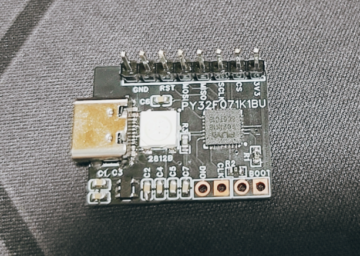
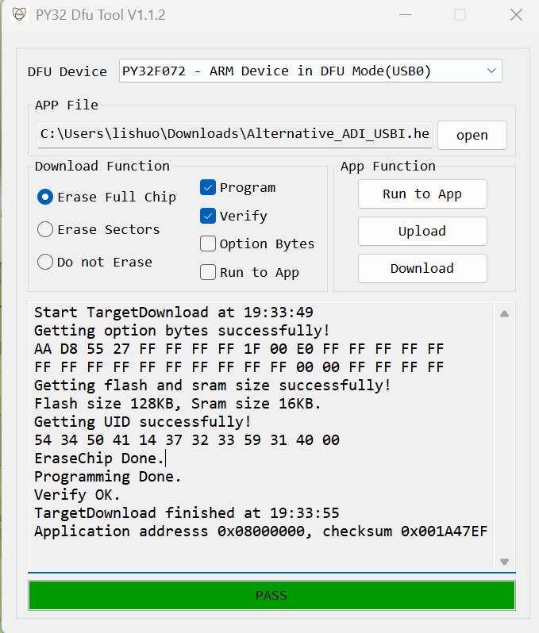

# PY32F071-ADI-USBi

**一个廉价、开源、几乎零外围的 Analog Devices USBi 仿真器 / 调试器**
**A cheap, open-source, near-zero-BOM Analog Devices USBi debugger**

*[中文](#中文) | [English](#english)*

---

## 中文

### 项目理念

Analog Devices 官方的 USBi 仿真器（`EVAL-ADUSB2EBZ`）是 SigmaStudio 与 ADAU 系列 DSP 之间的桥梁。它的核心是一颗 **Cypress CY7C68013A / CY7C68053（FX2LP / FX2LP18）**——一颗 2000 年代的 8051 + USB 2.0 全速控制器，必须配 24 MHz 外部晶振，还要外挂一颗 I2C EEPROM 存放固件。整个方案器件多、工具链老、芯片也不便宜。

**本项目想做的事很简单：用一颗几块钱的现代 ARM Cortex-M0+ 单片机，把这颗老芯片完整替代掉。**

于是有了这个基于 **PY32F071K1BU6** 的"虚拟 USBi"：

* 对 SigmaStudio 表现的形状与官方 USBi **完全一致**（同样的 VID/PID、同样的零端点单接口、同样的 EP0 vendor 请求），插上去就能被识别，不需要改任何上位机配置；
* **不需要外部晶振**：内部 HSI 24 MHz 经 PLL ×2 得到 48 MHz 系统时钟；固件直接跑在片内 128 KB Flash 里，**不需要外挂 EEPROM**；
* **几乎不需要任何外围器件**：除了 USB 接口本身和 4 根连到 DSP 的控制线，只需要**一颗 WS2812 灯珠**；
* 用这颗 WS2812 当调试指示灯，**工作状态一眼就能看清**：连没连上、走的是哪条总线、是在写还是在读、是不是在烧 EEPROM，全用颜色和闪法区分；**并且提供了三种显示风格，编译期一行宏切换**（见下文）。

> 🆕 **v1.2.0（2026-10-21）**：三种 LED 模式、WS2812 峰值闪杂色修复、**I²C 后端真正可用**（硬件 I2C1，400 kHz）。详见[更新日志](#更新日志)。

### 功能状态

| 功能 | 状态 |
|---|---|
| USB 全速设备枚举（VID `0x0456` / PID `0x7031`，单接口 class `0xFF`，零端点） | ✅ 已实现，网友打板实测 |
| EP0 vendor 请求：`0xB2` 写寄存器 / `0xB3` 读请求 / `0xB4` 读响应 / `0xB5`·`0xB6` 状态 | ✅ 已实现；`0xB5`/`0xB6` 现在返回**真实结果**（`1` = 成功 / `3` = 失败） |
| SPI 从机口调试：寄存器读写、程序/参数下载、safeload、写后回读 | ✅ 已实现，网友打板实测 |
| > 4096 字节的超长块写（EP0 流式接收，256 字节一块边收边发） | ✅ 已实现（用于 EEPROM 烧录流程中的 12568 字节整幅镜像） |
| 目标复位线控制（PB0，常态输出高） | ✅ 已实现 |
| WS2812 状态指示 | ✅ 已实现，**三种显示模式编译期可选** |
| **I²C 从机口调试** | ✅ **v1.2.0 起已实现**（硬件 I2C1 + HAL，400 kHz，分块/延时按参考工程实测值）；代码完成、离线验证通过，**等待有 I²C 接线的板子实测** |

### 三种 LED 显示模式

显示风格由**编译期宏** `USBI_LED_MODE` 决定（`firmware/Core/INC/usbi_led.h`），运行时不可切换。
三种模式都包含读/写活动脉冲与烧录闪，区别只在"没在通信的时候亮不亮"。

| 模式 | 宏值 | 未枚举（没插电脑） | 枚举后空闲 | 读/写命令 | 下载/烧录 | 适合 |
|---|---|---|---|---|---|---|
| **1 · 经典** | `USBI_LED_MODE=1` | 白色呼吸 | 模式色呼吸（SPI 绿 / I²C 紫） | 写 = 蓝脉冲，读 = 紫脉冲 | 青色高频闪 | 想一眼看出上电是否正常，把灯当"心跳" |
| **2 · 插入才亮** | `USBI_LED_MODE=2` | **全灭** | 模式色呼吸 | 同上 | 同上 | 不想让机器在断电 / 待机时亮着 |
| **3 · 只有活动才亮**（默认） | `USBI_LED_MODE=3` | **全灭** | 呼吸 **3 秒**后**自动熄灭** | 同上 | 同上 | 最安静：不通信就全黑，一眼看出总线忙不忙 |

模式 3 的细节：

* 枚举成功后先呼吸 **3 秒**（`USBI_LED_ANNOUNCE_MS`，默认 3000，可改）当"我认到主机了"的确认，然后彻底熄灭；
* 之后只有活动才亮：每条读 / 写命令一个脉冲，下载 / 烧录时青色闪；
* 活动**不会**重置那 3 秒——否则 SigmaStudio 一打开就在轮询，灯会永远呼吸；
* 拔掉 USB 立刻灭。

烧录闪的两种响应（三种模式一致）：

* **写命令** → 相位拉回"亮"：命令落在暗相位时灯马上变亮；搬 program data 时命令很密，灯基本保持亮；
* **读命令** → 打一个"凹口"：灯亮着就压暗一帧（约 20 ms），灯暗着就补亮一帧。读永远落在当前状态的反面，所以哪怕灯一直亮着，每一条读也看得见；
* 命令之间的间隙由 40/40 ms 的方波继续闪。

颜色与亮度全部在 `Core/INC/usbi_led.h` 顶部定义：

| 状态 | 颜色 | 宏 |
|---|---|---|
| 未枚举 | 白 `(64,64,64)` | `USBI_LED_OFF_*` |
| 空闲（SPI） | 绿 `(0,64,0)` | `USBI_LED_SPI_*` |
| 空闲（I²C） | 紫 `(64,0,107)` | `USBI_LED_I2C_*` |
| 正在写入 | 蓝 `(0,0,127)` | `USBI_LED_WRITE_*` |
| 正在读出 | 紫 `(64,0,96)` | `USBI_LED_READ_*` |
| 正在烧录 | 青 `(0,96,64)` | `USBI_LED_BURN_*` |

`USBI_LED_PEAK_LEVEL`（默认 `127`）把呼吸峰值压到半亮：省电，同时把 WS2812 在峰值处的时序余量放大（见[更新日志](#更新日志)里"峰值闪杂色"那条）。

**怎么切模式**

```c
/* firmware/Core/INC/usbi_led.h */
#define USBI_LED_MODE  USBI_LED_MODE_CLASSIC   /* 1 / 2 / 3 */
```

或者不改文件，编译时加宏（优先级更高）：

```
-DUSBI_LED_MODE=1
```

非 1/2/3 的值会被 `#error` 拦住，避免静默变成别的行为。

### 硬件

**v1.0 已经由网友帮忙打样并实际焊接验证通过** —— 感谢！下面所有"✅ 已实测"的行为都以这块板为准。



| 项目 | 说明 |
|---|---|
| MCU | PY32F071K1BU6（Cortex-M0+，48 MHz，128 KB Flash / 16 KB RAM，QFN32） |
| 时钟 | 内部 HSI 24 MHz + PLL ×2 = 48 MHz，**无外部晶振** |
| USB | 全速 12 Mbps 设备，仅用 EP0；`D+` 需 **1.5 kΩ 上拉到 3.3 V**（全速设备标识） |
| 外围器件 | 1 颗 WS2812(B) 灯珠 + 若干去耦电容，**无 EEPROM、无晶振** |
| 资源占用（v1.2.0） | `text 23520 / data 4216 / bss 3360` → RAM 7576 / 16384 B，Flash ≈ 27.7 KB / 128 KB |

#### PCB 工程

| 版本 | 文件 | 说明 |
|---|---|---|
| v1.0 | [`hardware/alternative_usbi_v1.0.eprj2`](hardware/alternative_usbi_v1.0.eprj2) | 嘉立创 EDA **专业版**工程（`.eprj2` 为 SQLite 单文件，用嘉立创 EDA 专业版直接打开） |
| v1.0（旧） | `hardware/alternative_usbi_v1.0.epro2` | 嘉立创 EDA 标准版工程（早期导出版本，保留） |
| v1.0 | `hardware/SCH_alternative_usbi_v1.0_2026-10-12.pdf` | 原理图 PDF |

实拍照片：[`hardware/board-v1.0.png`](hardware/board-v1.0.png)。

### 引脚接线

| PY32F071 | 功能 | 接到 ADAU145x 从机控制口 |
|---|---|---|
| `PA4` | SPI1_CS（软件控制） | `SS/ADDR0`（pin33） |
| `PA5` | SPI1_SCK | `CCLK/SCL`（pin31） |
| `PA6` | SPI1_MISO | `MISO/SDA`（pin30） |
| `PA7` | SPI1_MOSI | `MOSI/ADDR1`（pin32） |
| `PA9` | I²C1_SCL（AF6，开漏 + 上拉） | `CCLK/SCL`（I²C 模式） |
| `PA10` | I²C1_SDA（AF6，开漏 + 上拉） | `MISO/SDA`（I²C 模式） |
| `PB0` | 目标 RESET 输出（空闲高 = 释放） | `RESET`（pin24） |
| `PB9` | WS2812 数据（TIM17_CH1 + DMA1_Ch1） | WS2812 DIN |
| `PA11` / `PA12` | USB D- / D+（USB 外设自动接管） | USB 口 |

SPI 参数：主机模式、Mode 0（CPOL=0 / CPHA=1Edge）、MSB first、8 bit、分频 16 → **3 MHz**。`SS` 由软件在每次事务前后拉低/拉高。

ADAU 地址语义：`>= 0xF000` 为寄存器，按字节递增；`< 0xF000` 为存储器，按 4 字节字递增（`usbi.c` 的 `bus_write_at()` 已处理）。

### 总线选择：SPI 还是 I²C

`firmware/Core/INC/usbi.h` 的 `USBI_BUS_SELECT` 编译期三选一：

| 值 | 模式 | 说明 |
|---|---|---|
| `USBI_BUS_SPI`（`0`，默认） | SPI | PA4 软件片选 + PA5/6/7，3 MHz |
| `USBI_BUS_I2C`（`1`） | I²C | 硬件 I2C1，PA9/PA10，**400 kHz**（与官方 USBi 一致） |
| `USBI_BUS_AUTO`（`2`） | 自动 | 上电先探 I²C 从机 `0x38~0x3B`，探到走 I²C，否则退回 SPI |

I²C 后端的分块与延时取参考工程 `adau1452-esp32-controller` 的实测值：
寄存器区 24 字节 / 程序区快路径 248 字节（保守路径 4 字节 = 一个 32 位字）/ 参数区 28 字节 / 读 240 字节，
程序区每块后 300 µs settle；失败时做 9 个时钟 + STOP 的总线恢复，再重试 3 次。

三个必须知道的点：

1. **切总线前要硬复位目标**：ADAU145x 上电默认 I²C 从口，`SS/ADDR0` 被拉低 3 次后会**永久**锁进 SPI 模式，软复位 `0xF890` 也回不来——SPI 与 I²C 之间是一道单向门。
2. **I²C 需要 2 kΩ 上拉**：`CCLK/SCL` 与 `MISO/SDA` 各挂一个 2 kΩ 到 3.3 V。只靠 MCU 内部上拉（30~50 kΩ）上升沿跟不上，读回会变成 `0xFF`。
3. **SysTick 必须是最高优先级**：vendor 请求都在 USB 中断里跑，而 HAL 的 I²C 超时基于 `HAL_GetTick()`。如果 SysTick 优先级低于 USB 中断，中断里 `uwTick` 不前进、超时永远不成立，总线一被从机拉死就会永久卡在中断里（只能等 IWDG 2 s 复位）。本工程把 `TICK_INT_PRIORITY` 设为 `PRIORITY_HIGHEST`、`USB_IRQn` 优先级降到 `1`，两处都有注释，**别改回去**。

### 预编译固件

不想折腾编译环境的，直接烧这些文件。

📦 **也可以在 [Releases](https://github.com/lishuo4096/PY32F071-ADI-USBi/releases) 页面直接下载**（`v1.2.0` 已附三种模式的 hex / bin 与校验和），不用 clone 整个仓库。

**v1.2.0 —— 三种 LED 模式各一份**（总线为默认 SPI，芯片 PY32F071K1BU6）：

| 文件 | LED 模式 | Flash 占用 | 说明 |
|---|---|---|---|
| `firmware/prebuilt/v1.2.0/Alternative_ADI_USBI_v1.2.0_led-classic.hex` | 1 · 经典 | 27 716 B | 未枚举白呼吸 / 枚举后绿呼吸 / 烧录闪 |
| `firmware/prebuilt/v1.2.0/Alternative_ADI_USBI_v1.2.0_led-after-enum.hex` | 2 · 插入才亮 | 27 720 B | 未枚举全灭 / 枚举后绿呼吸 |
| `firmware/prebuilt/v1.2.0/Alternative_ADI_USBI_v1.2.0_led-activity-only.hex` | 3 · 只有活动才亮 | 27 736 B | 枚举后呼吸 3 s 即灭，只有读写与烧录才亮 |

每个模式都同时提供 `.hex`（推荐，带地址）与 `.bin`（从 `0x08000000` 起烧），
校验和见 `firmware/prebuilt/v1.2.0/SHA256SUMS`，构建清单见 `.../manifest.json`。
需要 **I²C 总线**的固件请自己编一份：`-DUSBI_BUS_SELECT=1`（见[总线选择](#总线选择spi-还是-i²c)）。

**v1.0 —— 旧版**（LED 单一行为，I²C 未启用）：

| 文件 | 说明 |
|---|---|
| `firmware/prebuilt/Alternative_ADI_USBI.hex` | Intel HEX，用 PY32 DFU 工具 / 编程器直接下载 |
| `firmware/prebuilt/Alternative_ADI_USBI.bin` | 原始二进制镜像（烧录起始地址 `0x08000000`） |

### 安装驱动（Windows）

Windows 默认不认识这个设备，需要手动指定 Cypress 的驱动：

1. 把板子插上 USB。打开**设备管理器**，会看到一个带黄色感叹号的 **未知设备 / Unknown Device**；
2. 右键该设备 → **更新驱动程序** → **浏览我的电脑上的驱动程序**；
3. 点"浏览"，选择本仓库 `driver\` 下**与你系统对应**的文件夹（Win10 / Win11 64 位选 `driver\Win10\x64`，32 位选 `driver\Win10\x86`；Win7 选 `driver\Win7\x64`，Win8 / 8.1 / Vista / XP 以此类推），勾选**包括子文件夹**，确定；
4. 安装完成后，设备名会变成 **Cypress FX2LP No EEPROM Device** —— 这时 SigmaStudio 就能认出 USBi 了。

> **说明**：这是**原版社区 CY7C68013A 版 USBi 的驱动安装过程**，本项目直接借用了 Cypress 的驱动层（CyUSB3）。之所以能这么做，是因为固件对外的 VID/PID 与描述符形状（单接口 `class 0xFF`、零端点）和官方 USBi 完全一致，SigmaStudio 和 CyUSB 认的正是这一层。
> 文件夹里的 `ADI_USBi.spt` 是官方 USBi 的 8051 固件镜像，**本项目不需要它**，留在这里仅作参考。

### 烧录固件（PY32 DFU）

1. 把 **`PF8`（BOOT0）引脚拉低**，然后给板子上电 —— 单片机进入 ROM bootloader，不再运行用户程序；
2. 用 USB 线把板子连到电脑；
3. 打开 `PY32_DfuTool_V1.1.2\PY32DfuTool_x64.exe`（32 位系统用 `_x86`），工具里会自动识别到设备；
4. 选择 `firmware/prebuilt/v1.2.0/Alternative_ADI_USBI_v1.2.0_led-activity-only.hex`（或其它模式 / 自己编译出来的 hex），点下载；
5. 烧完断开 BOOT0 拉低（恢复悬空），**重新上电**，固件就开始运行了。



*PY32 DfuTool V1.1.2 的实际界面：`DFU Device` 一栏自动识别到 `PY32F072 - ARM Device in DFU Mode`，`APP File` 选好 hex，勾上 `Program` + `Verify`，点 **Download**；日志出现 `Programming Done.` / `Verify OK.`、底部变成绿色 **PASS** 就烧好了。*

### 编译与使用

1. 用 **EIDE** / VS Code 打开 `firmware/EIDE/Alternative_ADI_USBI.code-workspace`（工程清单在 `firmware/EIDE/.eide/`，新增 `.c` 文件必须登记进去）；
2. 编译器：`arm-none-eabi-gcc`（`-mcpu=cortex-m0plus -mthumb`）；
3. 想改显示风格 / 总线，加预处理宏：`-DUSBI_LED_MODE=1|2|3`、`-DUSBI_BUS_SELECT=0|1|2`；
4. 编译产物烧进芯片（SWD 或 `PY32_DfuTool`）；
5. 把 4 根控制线 + RESET 接到目标 DSP 板，插上 USB；
6. 打开 SigmaStudio 4.7，硬件配置里选 USBi，即可正常下载程序、读写参数。

### 目录结构

```
main/
├─ driver/                 Cypress CyUSB3 驱动（按系统分文件夹，见上文驱动安装）
├─ firmware/               ← 本项目的 EIDE 固件工程
│  ├─ prebuilt/
│  │  ├─ v1.2.0/           预编译固件（三种 LED 模式，hex + bin + SHA256SUMS + manifest.json）
│  │  └─ Alternative_ADI_USBI.hex/.bin   旧版 V1.0 预编译固件
│  ├─ Core/                main.c、usbi.c（协议 + 总线后端）、usbi_led.c、ws2812.c 等
│  ├─ Drivers/             PY32F071 HAL / CMSIS
│  ├─ Middlewares/         CherryUSB USB 协议栈 + FreeRTOS
│  ├─ EIDE/                工程清单、链接脚本、启动文件
│  └─ unused.md            已退休的软件模拟 I²C 实现（含恢复步骤，留作参考）
├─ hardware/               原理图 PDF + 嘉立创 EDA 工程（epro2 / eprj2）+ 实拍照片
└─ PY32_DfuTool_V1.1.2/    官方串口下载工具
```

### 更新日志

#### v1.2.0（2026-10-21）

**LED 三种模式**（编译期切换，见[上文](#三种-led-显示模式)）：经典 / 插入才亮 / 只有活动才亮。

**修复：绿色呼吸到峰值时偶尔闪一下杂色（橙色）**

* 现象：空闲呼吸到最亮的瞬间偶尔闪一下橙色（不是烧录指示）。
* 根因：一帧只有 1 颗灯 = 24 bit。空闲呼吸用的是绿 `(0,64,0)`，峰值那一帧绿字节是 `0b00111111`，红字节恒为 0；只要帧内**错一位**（多一个高脉冲或少一位），最低那个 `1` 就会掉进红色字节的 MSB → 红 = `0x80 = 128`，视觉上就是橙色。所以它**只在峰值**出现：非峰值时绿字节 LSB 是 0，错位只是绿暗一点。
* 修法（`firmware/Core/SRC/ws2812.c`）：帧起点确定化（发送前清 `CNT` 并清 UEV 标志）；DMA 卡死兜底（`CCR_EN = 0` 时主动 `HAL_DMA_Abort`）；DMA 通道优先级提到 `VERY_HIGH`（一位只有 60 个时钟，晚到一次这位就被读成 1）；回调里清 UEV 标志；上层渲染去重，只在颜色变化时才重发。另把呼吸峰值降到 `USBI_LED_PEAK_LEVEL = 127`。

**I²C 后端真正可用**：`USBI_BUS_SELECT` 从"死宏"变成真开关；硬件 I2C1 + HAL，400 kHz；`0xB5`/`0xB6` 返回真实状态（1/3）。

**烧录指示更灵敏**：烧录期间任何一条读/写命令都留可见响应（写 → 相位拉回亮，读 → 打一个凹口），不再只对大块 program data 有反应。

**清理**：`i2c.c` 里把芯片当从机的垃圾配置（`OwnAddress1 = 0xA0`、双地址使能）关掉；旧的软件模拟 I²C 实现归档进 `firmware/unused.md`。

#### v1.0（2026-10-12）

首个可用版本：USB USBi 枚举（VID `0x0456` / PID `0x7031`）、EP0 vendor 请求、SPI 从机口调试、WS2812 状态灯、PB0 复位控制。

### 参考与致谢

* `rp2040-Analog-Devices-USBi`（Rust / embassy，真正的 USB USBi 仿真器实现）
* `adau1452-esp32-controller`（I²C 分块与延时、ADAU145x 地址语义参考）
* ADI《ADAU1452/1451/1450》数据手册 Rev.D（控制口时序、I²C/SPI 模式切换、下载流程）
* CherryUSB（USB device 协议栈）
* **感谢帮忙打样、焊接并实测 v1.0 PCB 的网友**——这版硬件的行为（枚举、SigmaStudio 连接、SPI 下载、WS2812 显示）都以那块板为准确认。

> 本项目为个人学习与开源实践，与 Analog Devices 无关；ADAU、SigmaStudio、USBi 是 Analog Devices 的商标。

---

## English

### Why this project exists

Analog Devices' official **USBi** in-circuit debugger (`EVAL-ADUSB2EBZ`) is the bridge between SigmaStudio and the ADAU DSP family. Its core is a **Cypress CY7C68013A / CY7C68053 (FX2LP / FX2LP18)** — a 2000s-era 8051 + USB full-speed controller that needs a 24 MHz crystal and an external I²C EEPROM to hold its firmware. Many parts, an old toolchain, and a chip that is not exactly cheap.

**The idea is simple: replace that legacy chip with one modern, inexpensive ARM Cortex-M0+ MCU.**

This repository is a **PY32F071K1BU6-based "virtual USBi"**:

* It presents **exactly the same shape** to SigmaStudio as the official USBi (same VID/PID, same single interface with zero endpoints, same EP0 vendor requests) — plug it in and it is recognized, with no host-side configuration changes.
* **No external crystal**: the internal HSI (24 MHz) is doubled by the PLL to a 48 MHz system clock, and the firmware lives in the on-chip 128 KB flash — **no external EEPROM either**.
* **Almost no external components**: besides the USB pins and the four control lines to the DSP, all it needs is **a single WS2812 LED**.
* That WS2812 doubles as a debug indicator, so **the current state is obvious at a glance** — and there are **three display styles, switchable at compile time** (see below).

> 🆕 **v1.2.0 (2026-10-21)**: three LED modes, fix for a rare colour glitch at the breathing peak, and a **working I²C backend** (hardware I2C1, 400 kHz). See the [changelog](#changelog).

### Status

| Feature | Status |
|---|---|
| USB full-speed enumeration (VID `0x0456` / PID `0x7031`, single class-`0xFF` interface, zero endpoints) | ✅ Implemented, verified on a community-fabricated board |
| EP0 vendor requests: `0xB2` write register / `0xB3` read request / `0xB4` read response / `0xB5`, `0xB6` status | ✅ Implemented; `0xB5`/`0xB6` now return the **real result** (`1` = success / `3` = failed) |
| SPI slave-port debugging: register read/write, program & parameter download, safeload, read-back | ✅ Implemented, verified on hardware |
| Block writes larger than 4096 bytes (streamed EP0 OUT, 256-byte chunks forwarded on the fly) | ✅ Implemented (for the 12568-byte image in the EEPROM burn flow) |
| Target reset line control (`PB0`, idles high) | ✅ Implemented |
| WS2812 status LED | ✅ Implemented, **three selectable display styles** |
| **I²C slave-port debugging** | ✅ **Implemented as of v1.2.0** (hardware I2C1 + HAL, 400 kHz, chunk sizes/delays from the reference implementation); code complete and verified offline, **awaiting a board with I²C wiring for hardware validation** |

### Three LED display modes

The style is chosen by the compile-time macro `USBI_LED_MODE` (`firmware/Core/INC/usbi_led.h`); it cannot be changed at run time. All three modes share the same read/write pulses and burn indicator — they differ only in what the LED does **while idle**.

| Mode | Macro | Not enumerated | Enumerated & idle | Read / write | Download | Good for |
|---|---|---|---|---|---|---|
| **1 · Classic** | `USBI_LED_MODE=1` | white breathing | mode-colour breathing (green on SPI / purple on I²C) | write = blue pulse, read = purple pulse | bright cyan blink | using the LED as a heartbeat |
| **2 · On connect only** | `USBI_LED_MODE=2` | **dark** | mode-colour breathing | same | same | no light when unplugged / idle |
| **3 · Activity only** (default) | `USBI_LED_MODE=3` | **dark** | breathes for **3 s**, then **off** | same | same | quietest: dark unless the bus is busy |

Mode 3 details: after enumeration the LED breathes for **3 seconds** (`USBI_LED_ANNOUNCE_MS`, default 3000) as a "host found me" confirmation, then goes dark; afterwards every read/write command produces a pulse and a download produces the cyan blink. Activity does **not** restart the 3-second timer (otherwise SigmaStudio's polling would keep the LED breathing forever). Unplugging turns it off immediately.

Colours live at the top of `Core/INC/usbi_led.h`: idle green `(0,64,0)`, idle purple `(64,0,107)`, write blue `(0,0,127)`, read purple `(64,0,96)`, burn cyan `(0,96,64)`, disconnected white `(64,64,64)`. `USBI_LED_PEAK_LEVEL` (default `127`) caps the breathing peak at half brightness.

Switch with `-DUSBI_LED_MODE=1|2|3` (or edit the default in the header). Invalid values are rejected by `#error`.

### Hardware

**The v1.0 board was fabricated, assembled and validated by a community member** — thanks! Everything marked "verified" above was confirmed on that board.


| Item | Detail |
|---|---|
| MCU | PY32F071K1BU6 (Cortex-M0+, 48 MHz, 128 KB flash / 16 KB RAM, QFN32) |
| Clock | Internal HSI 24 MHz × PLL2 = 48 MHz, **no external crystal** |
| USB | Full-speed 12 Mbps device, EP0 only; `D+` needs a **1.5 kΩ pull-up to 3.3 V** |
| External parts | One WS2812(B) LED plus decoupling, **no EEPROM, no crystal** |
| Footprint (v1.2.0) | `text 23520 / data 4216 / bss 3360` → RAM 7576 / 16384 B, flash ≈ 27.7 KB / 128 KB |

PCB sources: [`hardware/alternative_usbi_v1.0.eprj2`](hardware/alternative_usbi_v1.0.eprj2) (JLC EDA **Pro**, SQLite single-file project), `hardware/alternative_usbi_v1.0.epro2` (JLC EDA standard edition, kept), `hardware/SCH_alternative_usbi_v1.0_2026-10-12.pdf` (schematic), [`hardware/board-v1.0.png`](hardware/board-v1.0.png) (photo).

### Wiring

| PY32F071 | Function | ADAU145x slave control port |
|---|---|---|
| `PA4` | SPI1_CS (software driven) | `SS/ADDR0` (pin33) |
| `PA5` | SPI1_SCK | `CCLK/SCL` (pin31) |
| `PA6` | SPI1_MISO | `MISO/SDA` (pin30) |
| `PA7` | SPI1_MOSI | `MOSI/ADDR1` (pin32) |
| `PA9` | I²C1_SCL (AF6, open drain + pull-up) | `CCLK/SCL` (I²C mode) |
| `PA10` | I²C1_SDA (AF6, open drain + pull-up) | `MISO/SDA` (I²C mode) |
| `PB0` | Target `RESET` output (idle high) | `RESET` (pin24) |
| `PB9` | WS2812 data (TIM17_CH1 + DMA1_Ch1) | WS2812 DIN |
| `PA11` / `PA12` | USB D- / D+ | USB connector |

SPI: master, Mode 0 (CPOL=0 / CPHA=1Edge), MSB first, 8-bit, prescaler 16 → **3 MHz**; `SS` is driven by software around each transaction.
ADAU addressing: `>= 0xF000` are registers (byte-incrementing), `< 0xF000` are memories (4-byte word incrementing).

### Bus: SPI or I²C

`USBI_BUS_SELECT` in `firmware/Core/INC/usbi.h`:

| Value | Mode | Notes |
|---|---|---|
| `USBI_BUS_SPI` (`0`, default) | SPI | PA4 software CS + PA5/6/7, 3 MHz |
| `USBI_BUS_I2C` (`1`) | I²C | hardware I2C1, PA9/PA10, **400 kHz** |
| `USBI_BUS_AUTO` (`2`) | auto | probe `0x38~0x3B` at boot, fall back to SPI if nothing answers |

Chunk sizes matching the reference implementation: 24 bytes for registers, 248 for the program region (conservative path: 4 bytes = one 32-bit word), 28 for parameters, 240 for reads, plus a 300 µs settle after each program-region chunk. Failures trigger a 9-clock + STOP bus recovery and up to 3 retries.

Three things you must know:

1. **Hardware-reset the target before switching buses**: the ADAU145x powers up in I²C mode, but pulling `SS/ADDR0` low three times latches it into SPI mode **permanently** (a `0xF890` soft reset will not undo it). SPI ↔ I²C is a one-way door.
2. **I²C needs 2 kΩ pull-ups** on both `CCLK/SCL` and `MISO/SDA`. With only the MCU's internal pull-ups the edges are too slow and reads come back as `0xFF`.
3. **SysTick must have the highest priority**: vendor requests run inside the USB interrupt, and HAL's I²C timeouts are based on `HAL_GetTick()`. If SysTick has a lower priority than USB, `uwTick` freezes inside the ISR, the timeout never fires, and a stuck bus hangs the interrupt forever (only the 2 s watchdog recovers). This project sets `TICK_INT_PRIORITY = PRIORITY_HIGHEST` and `USB_IRQn` priority = `1`; both are commented — **do not revert them**.

### Prebuilt firmware

📦 **Or grab them from the [Releases](https://github.com/lishuo4096/PY32F071-ADI-USBi/releases) page** — `v1.2.0` ships all three modes as hex / bin plus checksums, no clone needed.

**v1.2.0 — one build per LED mode** (SPI bus, PY32F071K1BU6):

| File | LED mode | Flash | Notes |
|---|---|---|---|
| `firmware/prebuilt/v1.2.0/Alternative_ADI_USBI_v1.2.0_led-classic.hex` | 1 · Classic | 27 716 B | white breathing when unplugged, green when enumerated |
| `firmware/prebuilt/v1.2.0/Alternative_ADI_USBI_v1.2.0_led-after-enum.hex` | 2 · On connect only | 27 720 B | dark until enumerated |
| `firmware/prebuilt/v1.2.0/Alternative_ADI_USBI_v1.2.0_led-activity-only.hex` | 3 · Activity only | 27 736 B | 3 s greeting, then dark except for activity |

Each mode ships as `.hex` (recommended) and `.bin` (load address `0x08000000`); checksums in `firmware/prebuilt/v1.2.0/SHA256SUMS`. For an **I²C** build, compile your own with `-DUSBI_BUS_SELECT=1`.

**v1.0 — legacy**: `firmware/prebuilt/Alternative_ADI_USBI.hex` / `.bin`.

### Installing the driver (Windows)

Windows does not know this device out of the box, so you have to point it at the Cypress driver manually:

1. Plug the board into USB. In **Device Manager** an **Unknown Device** appears with a yellow warning triangle;
2. Right-click it → **Update driver** → **Browse my computer for drivers**;
3. Click *Browse* and select the folder under `driver\` that **matches your OS** (Windows 10 / 11 64-bit → `driver\Win10\x64`, 32-bit → `driver\Win10\x86`; Windows 7 → `driver\Win7\x64`). Keep **Include subfolders** checked and confirm;
4. Once it finishes, the device is renamed to **Cypress FX2LP No EEPROM Device** — SigmaStudio will now find the USBi.

> **Note**: this is the very same procedure as the **original community CY7C68013A-based USBi**; this project simply reuses the Cypress driver layer (CyUSB3), because the firmware presents the same VID/PID and descriptor shape as the official USBi.
> `ADI_USBi.spt` in that folder is the official USBi's 8051 firmware image; **this project does not need it** — it is kept for reference only.

### Flashing the firmware (PY32 DFU)

1. Pull the **`PF8` (BOOT0) pin low**, then power the board up — the MCU enters its ROM bootloader;
2. Connect the board to your PC with a USB cable;
3. Launch `PY32_DfuTool_V1.1.2\PY32DfuTool_x64.exe` (`_x86` on 32-bit systems); the tool detects the device automatically;
4. Select `firmware/prebuilt/v1.2.0/Alternative_ADI_USBI_v1.2.0_led-activity-only.hex` (or another mode / your own build) and click download;
5. Release BOOT0 and **power-cycle the board** — the new firmware starts running.


### Build & use

1. Open `firmware/EIDE/Alternative_ADI_USBI.code-workspace` with **EIDE** / VS Code (the project manifest is under `firmware/EIDE/.eide/`; new `.c` files must be registered there);
2. Toolchain: `arm-none-eabi-gcc` (`-mcpu=cortex-m0plus -mthumb`);
3. To change the LED style or bus, add `-DUSBI_LED_MODE=1|2|3` / `-DUSBI_BUS_SELECT=0|1|2`;
4. Flash the firmware (SWD or `PY32_DfuTool`);
5. Wire the control lines plus `RESET` to your DSP board and plug in USB;
6. Open SigmaStudio 4.7, select USBi in the hardware configuration, and download programs / read and write parameters as usual.

### Changelog

**v1.2.0 (2026-10-21)**

* Three compile-time LED modes: classic / on-connect-only / activity-only.
* Fixed a rare orange flash at the breathing peak. A frame is 24 bits for a single LED; at the peak the green byte is `0b00111111` and the red byte is 0, so **any single-bit slip** moves the lowest `1` into the red byte's MSB (red = `0x80`) and the LED looks orange for a frame. Fixed by making the frame start deterministic (reset `CNT`, clear the UEV flag), a DMA-stuck guard (`HAL_DMA_Abort` when `CCR_EN` is clear), DMA priority `VERY_HIGH`, clearing the UEV flag in the transfer-complete callback, and de-duplicating renders. The breathing peak is also capped via `USBI_LED_PEAK_LEVEL = 127`.
* Working I²C backend: `USBI_BUS_SELECT` is now a real switch; hardware I2C1 + HAL at 400 kHz; `0xB5`/`0xB6` report real status (1/3).
* Every read/write command now produces a visible reaction during a burn (writes pull the phase bright, reads cut a short notch).
* Cleanup: removed the slave-mode leftovers in `i2c.c`; the retired software bit-banged I²C implementation is archived in `firmware/unused.md`.

**v1.0 (2026-10-12)**: first working version — enumeration, EP0 vendor requests, SPI slave-port debugging, WS2812 indicator, PB0 reset control.

### Credits

* `rp2040-Analog-Devices-USBi` (Rust / embassy — a real USB USBi emulator implementation)
* `adau1452-esp32-controller` (I²C chunking/delays and ADAU145x addressing reference)
* Analog Devices *ADAU1452/1451/1450* datasheet Rev.D (control-port timing, I²C/SPI mode latching, download procedure)
* CherryUSB (USB device stack)
* **Thanks to the community member who fabricated, assembled and validated the v1.0 PCB** — every hardware behaviour reported here was confirmed on that board.

> A personal learning and open-source project, not affiliated with Analog Devices. ADAU, SigmaStudio and USBi are trademarks of Analog Devices.
